# Faster R-CNN ile Uçak Tespiti (2019)

Fotoğraflardaki uçakları tespit eden bir nesne tespiti çalışmasıdır. 2019 yılında, TEKNOFEST Savaşan İHA yarışmasına başvurmadan önce görüntü tabanlı hava aracı tespiti üzerine bir ön çalışma olarak yapılmıştır.

TensorFlow Object Detection API'nin COCO üzerinde önceden eğitilmiş Faster R-CNN Inception v2 modeli, Open Images veri setinden alınan uçak fotoğraflarıyla tek sınıf (uçak) için yeniden eğitilmiştir. Eğitim sırasında her checkpoint test setinde değerlendirilmiş ve en iyi model seçilerek test görselleri üzerinde tespit yapılmıştır.

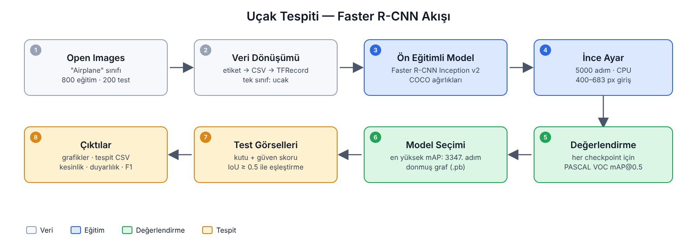

## Kullanılan teknolojiler

| Bileşen | Sürüm | Kullanım amacı |
|---|---|---|
| Python | 3.7.4 | Ana dil |
| TensorFlow | 1.14.0 (CPU) | Eğitim ve çıkarım |
| TF Object Detection API | tensorflow/models v1.13.0 | Faster R-CNN, eğitim (`legacy/train.py`) ve değerlendirme (`legacy/eval.py`) |
| Faster R-CNN Inception v2 | `faster_rcnn_inception_v2_coco_2018_01_28` | COCO ağırlıklarıyla başlangıç modeli |
| OpenCV | 4.1.0 | Görsel okuma ve çizim |
| pandas, NumPy | 0.24.2, 1.16.4 | Etiket tabloları ve sonuç analizi |
| matplotlib | 3.1.1 | Eğitim ve değerlendirme grafikleri |
| pycocotools | philferriere/cocoapi | Değerlendirme modülünün bağımlılığı |
| OIDv4_ToolKit | — | Open Images'tan sınıf bazlı veri indirme |

Eğitim GPU kullanılmadan, işlemci üzerinde yapılmıştır.

## Veri seti

Google'ın Open Images V4 veri setinin **Airplane** sınıfı kullanılmıştır. Görseller OIDv4_ToolKit ile indirilmiş, grup olarak işaretlenmiş (`IsGroupOf`) kutular alınmamıştır.

| Bölüm | Görsel | Kutu | Görsel başına kutu |
|---|---|---|---|
| Eğitim | 800 | 1399 | 1.75 |
| Test | 200 | 259 | 1.30 |

Etiketler `csv_olustur.py` ile CSV'ye, `tfrecord_olustur.py` ile TFRecord formatına çevrilmiştir. Tek sınıf `ucak` olarak tanımlanmıştır (`egitim/etiket_haritasi.pbtxt`).

Open Images görselleri Flickr kaynaklıdır ve CC BY 2.0 lisansıyla, etiketler CC BY 4.0 lisansıyla paylaşılmıştır. Veri seti repoya eklenmemiştir.

## Eğitim

Eğitim ayarları `egitim/faster_rcnn_ucak.config` dosyasındadır. Örnek pets config'i temel alınarak şu değişiklikler yapılmıştır:

| Ayar | Değer |
|---|---|
| Sınıf sayısı | 1 |
| Giriş boyutu | kısa kenar 400, uzun kenar en fazla 683 piksel |
| Batch | 1 |
| Adım | 5000 |
| Öğrenme oranı | 0.0002, 3500. adımdan sonra 0.00002 |
| Veri artırma | yatay çevirme |
| Değerlendirme metriği | PASCAL VOC mAP@0.5 |

Eğitim sırasında yaklaşık 10 dakikada bir checkpoint kaydedilmiş ve her checkpoint 200 test görselinde değerlendirilmiştir.

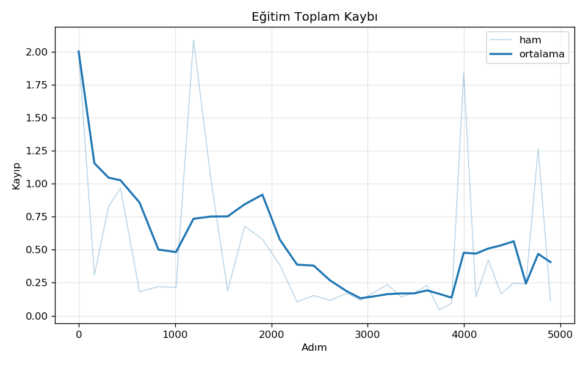

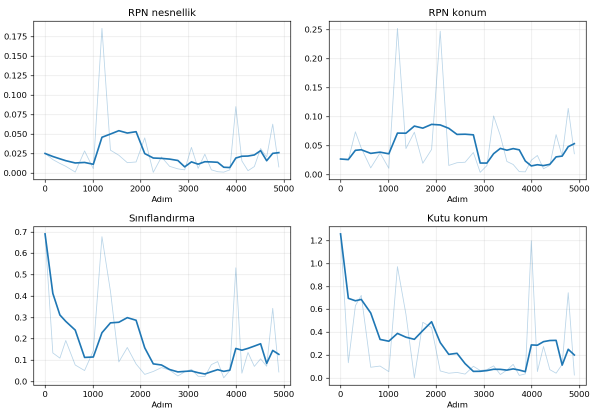

Batch boyutu 1 olduğu için kayıp değerleri adımdan adıma dalgalıdır; grafiklerde soluk çizgi ham değeri, koyu çizgi 5 noktalık ortalamayı göstermektedir. Toplam eğitim kaybı 2.00'dan 0.11'e düşmüştür.

## Değerlendirme ve model seçimi

| Adım | mAP@0.5 | Test kaybı |
|---|---|---|
| 828 | 0.890 | 0.623 |
| 1723 | 0.885 | 0.607 |
| 2609 | 0.887 | 0.590 |
| **3347** | **0.903** | **0.563** |
| 3996 | 0.900 | 0.579 |
| 4641 | 0.902 | 0.579 |
| 5000 | 0.902 | 0.578 |

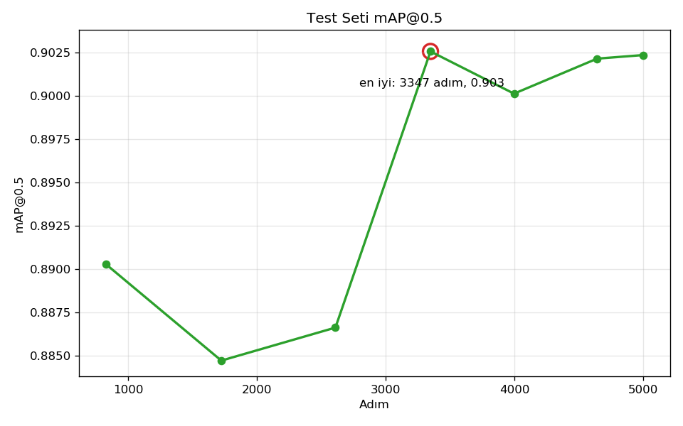

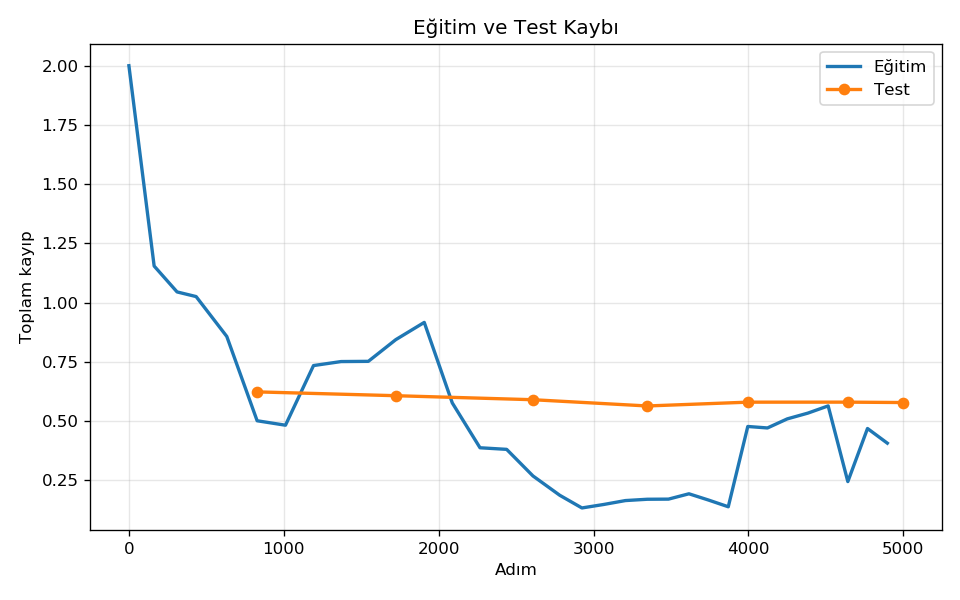

Başlangıç modeli COCO'da uçak sınıfını zaten tanıdığı için ilk checkpoint'te bile mAP 0.89 seviyesindedir. İnce ayar sonrasında mAP 3347. adımda 0.903'e ulaşmış, sonrasında 0.90 civarında sabit kalmıştır. Test kaybı da en düşük değerini aynı adımda almıştır. Bu nedenle eğitim uzatılmamış ve **3347. adımdaki checkpoint** son model olarak seçilmiştir.

Model seçimi ayrı bir doğrulama seti yerine test seti üzerinden yapılmıştır; bu yüzden raporlanan test sonuçları bir miktar iyimser olabilir.

## Tespit sonuçları

Seçilen model `export_inference_graph.py` ile donmuş grafa çevrilmiş ve `tespit.py` ile 200 test görselinde çalıştırılmıştır. 0.5 güven eşiğinin üzerindeki tespitler, gerçek kutularla IoU ≥ 0.5 koşuluyla eşleştirilmiştir.

| Ölçüt | Değer |
|---|---|
| Gerçek kutu | 259 |
| Doğru tespit | 226 |
| Yanlış tespit | 95 |
| Kaçırılan | 33 |
| Kesinlik | 0.704 |
| Duyarlılık | 0.873 |
| F1 | 0.779 |

200 görselin 126'sında hiç hata yapılmamıştır. Görsellerde yeşil kutu doğru tespiti, kırmızı kutu yanlış tespiti, turuncu kutu kaçırılan uçağı göstermektedir.

<table>
  <tr>
    <td>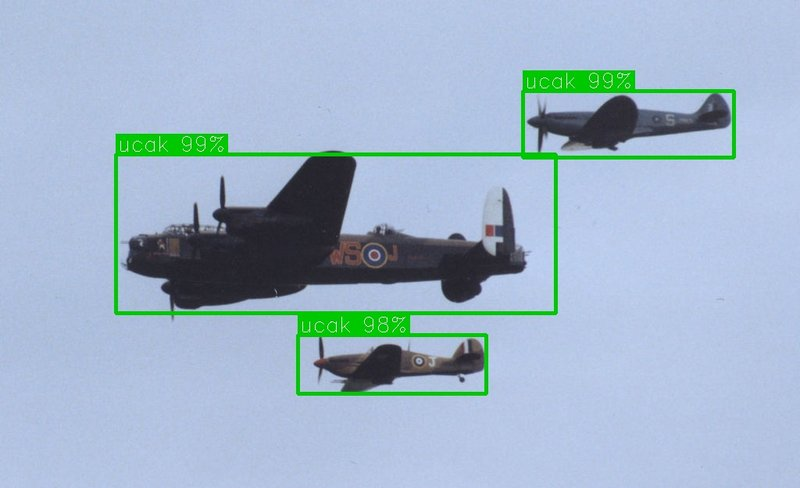</td>
    <td>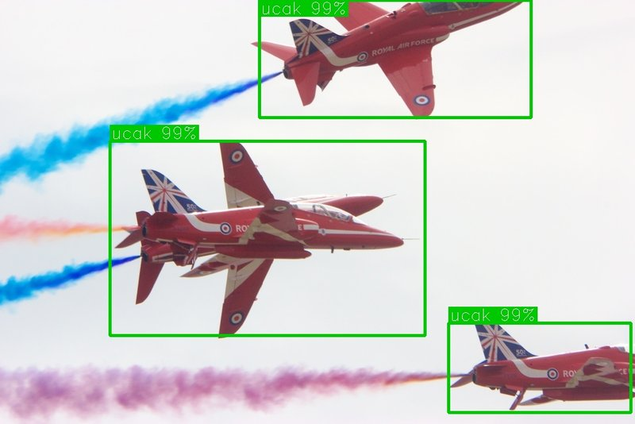</td>
    <td>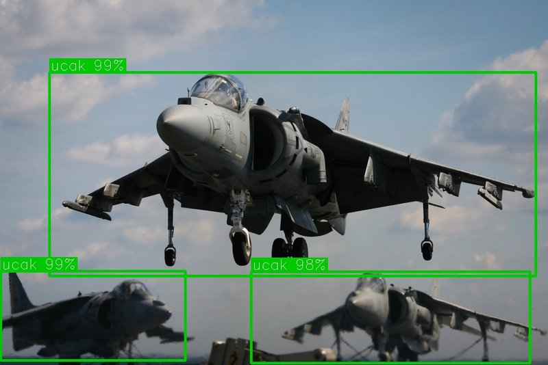</td>
  </tr>
  <tr>
    <td>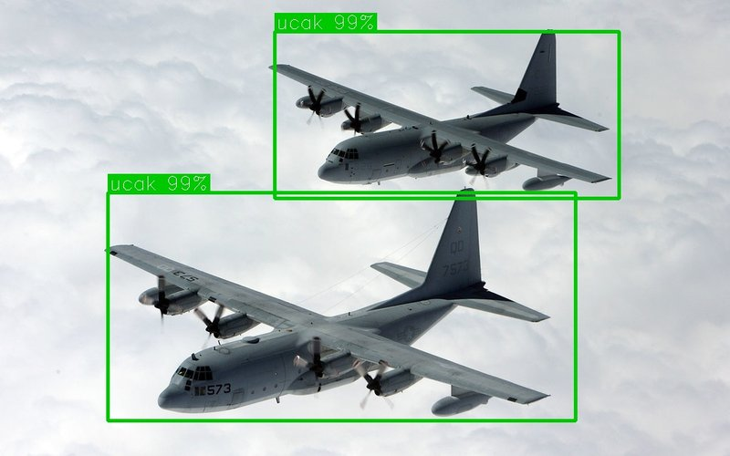</td>
    <td>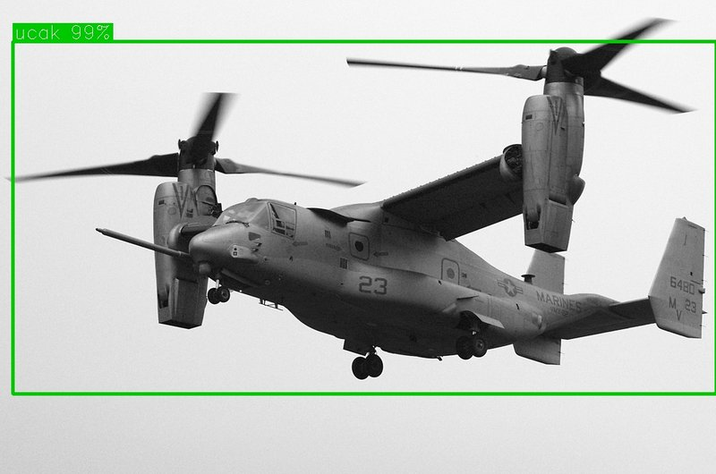</td>
    <td>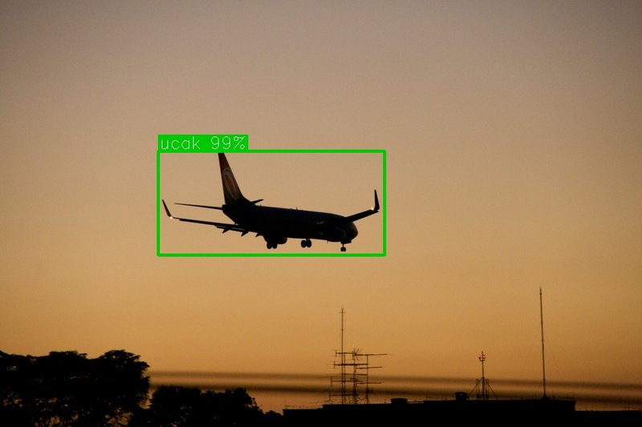</td>
  </tr>
</table>

### Hata analizi

<table>
  <tr>
    <td>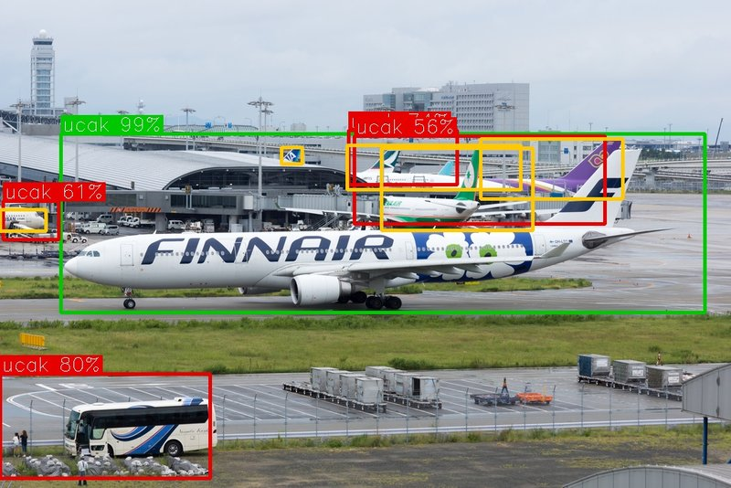</td>
    <td>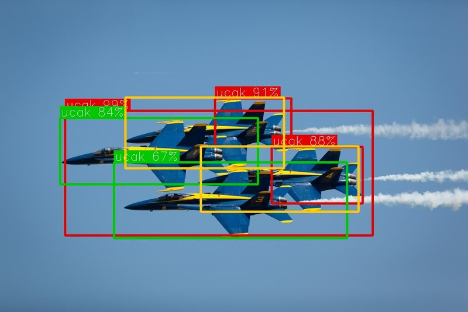</td>
  </tr>
</table>

Kesinliğin duyarlılıktan düşük olmasının başlıca sebepleri şunlardır:

- **Uzaktaki küçük uçaklar:** Havalimanı sahnelerinde arka plandaki uçaklar bulunmuş, ancak kutular gerçek kutuyla IoU 0.4–0.5 aralığında kaldığı için yanlış sayılmıştır. Küçük nesnelerde kutu konumu daha az isabetlidir.
- **Benzer nesneler:** Soldaki görselde havalimanı otobüsü 0.81 güvenle uçak olarak tespit edilmiştir.
- **Yakın uçuş formasyonları:** Sağdaki görselde birbirine çok yakın uçan uçaklarda kutular üst üste binmiş, bazı uçaklar birleştirilmiş ya da kaçırılmıştır.
- **Eksik etiketler:** Open Images'ta bazı görsellerde arka plandaki uçaklar etiketlenmemiştir; model bu uçakları bulduğunda tespit yanlış sayılmaktadır.

## Kurulum ve kullanım

```
python -m venv venv
venv\Scripts\activate
pip install -r requirements.txt
```

TF Object Detection API (tensorflow/models v1.13.0) ayrıca kurulmalı ve protobuf dosyaları `protoc` 3.8.0 ile derlenmelidir. Başlangıç modeli: http://download.tensorflow.org/models/object_detection/faster_rcnn_inception_v2_coco_2018_01_28.tar.gz

```
python csv_olustur.py
python tfrecord_olustur.py veri/train_etiketler.csv veri/OID/train/Airplane veri/train.record
python tfrecord_olustur.py veri/test_etiketler.csv veri/OID/test/Airplane veri/test.record

python object_detection/legacy/train.py --logtostderr --train_dir=egitim/ucak --pipeline_config_path=egitim/faster_rcnn_ucak.config
python object_detection/legacy/eval.py --logtostderr --checkpoint_dir=egitim/ucak --eval_dir=egitim/ucak_eval --pipeline_config_path=egitim/faster_rcnn_ucak.config

python object_detection/export_inference_graph.py --input_type image_tensor --pipeline_config_path egitim/faster_rcnn_ucak.config --trained_checkpoint_prefix egitim/ucak/model.ckpt-3347 --output_directory modeller/ucak_model

python grafik_ciz.py
python tespit.py
```

Eğitilmiş model dosyaları boyutları nedeniyle repoya eklenmemiştir.

## Dosya yapısı

```
csv_olustur.py              Open Images etiketlerini CSV'ye çevirir
tfrecord_olustur.py         CSV ve görsellerden TFRecord üretir
grafik_ciz.py               eğitim/değerlendirme kayıtlarından grafik ve CSV üretir
tespit.py                   test görsellerinde tespit, eşleştirme ve metrikler
egitim/                     config ve etiket haritası
sonuclar/                   kayıp, mAP ve tespit sonuçları, grafikler
readme_resimler/            README görselleri
```

## Kaynaklar

- S. Ren, K. He, R. Girshick, J. Sun, "Faster R-CNN: Towards Real-Time Object Detection with Region Proposal Networks", NeurIPS 2015.
- A. Kuznetsova vd., "The Open Images Dataset V4: Unified image classification, object detection, and visual relationship detection at scale", arXiv:1811.00982, 2018.
- TensorFlow Object Detection API: https://github.com/tensorflow/models/tree/master/research/object_detection
- OIDv4_ToolKit: https://github.com/EscVM/OIDv4_ToolKit
